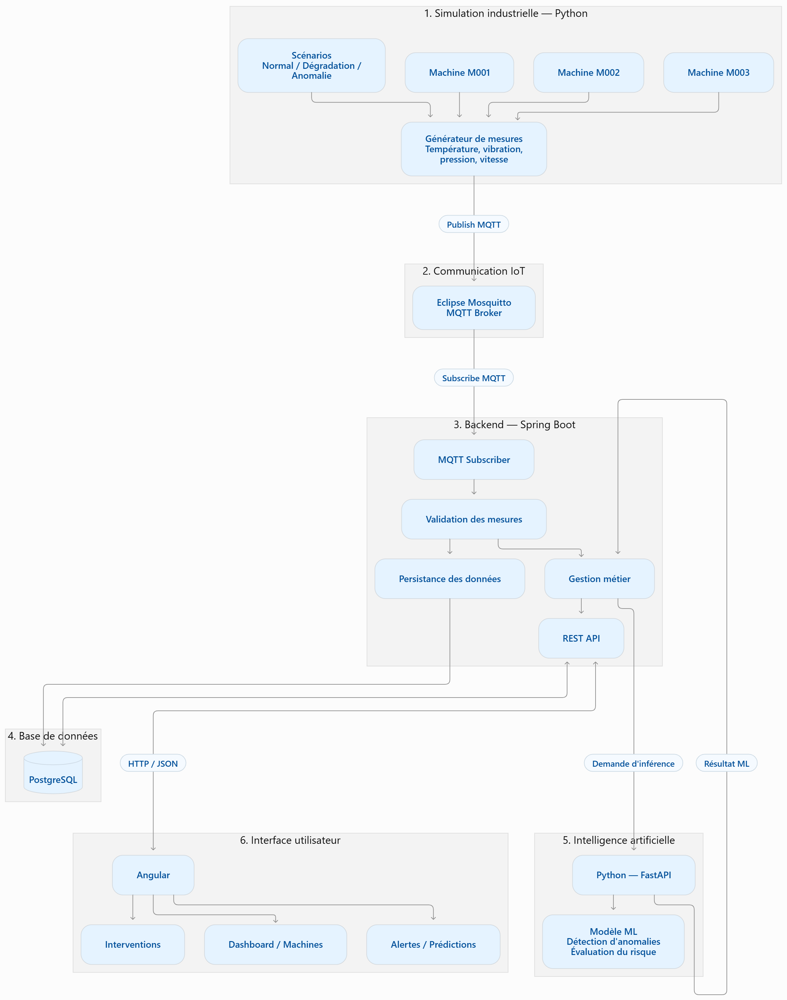

# 🏭 Système IoT Industriel pour la Maintenance Prédictive & Détection d'Anomalies

Bienvenue sur le projet **IOT-predictive-maintenance**, une plateforme complète d'**Industrie 4.0** dédiée à la surveillance en temps réel, à la détection proactive d'anomalies par intelligence artificielle et à la gestion des interventions de maintenance sur des équipements industriels.

---

## 📌 Présentation & Contexte

Dans les environnements industriels modernes, les pannes imprévues sur les lignes de production entraînent des coûts opérationnels majeurs et des arrêts de chaîne critiques. Ce projet propose une solution de **maintenance prédictive de bout en bout** :

1. **Collecte continue** : Émulation et capture de télémétries multi-capteurs sur différentes machines industrielles.
2. **Transport résilient** : Acheminement temps réel à faible latence via le protocole IoT standard MQTT.
3. **Traitement & Persistance** : Ingestion, validation et historisation des flux de données avec un cœur applicatif robuste.
4. **Diagnostic intelligent** : Détection précoce des dérives et anomalies grâce à des modèles de Machine Learning.
5. **Aide à la décision** : Interface utilisateur ergonomique offrant un monitoring temps réel, une gestion d'alertes et le suivi des ordres d'intervention.

---

## 🏗️ Architecture Globale du Système

L'architecture est découpée de manière modulaire en microservices et briques spécialisées, garantissant haute disponibilité, passage à l'échelle et découplage fort entre composants :



---

## 🧩 Description Détaillée du Projet en 5 Parties

Le projet s'articule autour de **5 parties interdépendantes et complémentaires** :

```
┌────────────────────────────────────────────────────────────────────────┐
│                        1. SIMULATION IOT                               │
│  Machines M001, M002, M003  ──(Température, Vibration, Pression...)   │
└───────────────────────────────────┬────────────────────────────────────┘
                                    │ Publish MQTT
                                    ▼
┌────────────────────────────────────────────────────────────────────────┐
│                        2. BROKER MQTT                                  │
│  Eclipse Mosquitto (Acheminement temps réel des messages)             │
└───────────────────────────────────┬────────────────────────────────────┘
                                    │ Subscribe MQTT
                                    ▼
┌────────────────────────────────────────────────────────────────────────┐
│                 3. BACKEND MÉTIER & PERSISTANCE                        │
│  Spring Boot (Ingestion, Validation, Règles métier) ◄──► PostgreSQL    │
└───────────────────────┬───────────────────────────────▲────────────────┘
   Demande d'inférence  │                               │ HTTP / JSON
                        ▼                               │
┌───────────────────────────────┐       ┌───────────────┴────────────────┐
│   4. INTELLIGENCE ARTIFICIELLE│       │    5. INTERFACE UTILISATEUR    │
│  FastAPI + Modèle ML          │       │  Angular (Dashboard, Alertes,  │
│  (Détection anomalies & risque│       │  Gestion des interventions)    │
└───────────────────────────────┘       └────────────────────────────────┘
```

---

### 1️⃣ Partie 1 : Simulation Industrielle & Génération de Télémétrie (Python)
* **Rôle** : Modéliser le comportement d'un parc de machines industrielles sans nécessiter d'équipements physiques au démarrage.
* **Équipements émulés** : Machine `M001`, Machine `M002`, Machine `M003`.
* **Grandeurs physiques mesurées** :
  * 🌡️ **Température** (°C) : Évolution thermique et détection d'échauffements anormaux.
  * 📳 **Vibration** (mm/s ou Hz) : Analyse spectrale des balourds, désalignements et jeux mécaniques.
  * ⏱️ **Pression** (bar) : Contrôle des circuits hydrauliques ou pneumatiques.
  * 🔄 **Vitesse de rotation** (RPM) : Surveillance des variations de régime moteur.
* **Scénarios d'exploitation simulés** :
  * **Régime Normal** : Variations statistiques nominales autour des points de consigne.
  * **Dégradation Progressive** : Dérive lente des indicateurs (usure des roulements, encrassement thermique).
  * **Anomalie Franche** : Rupture brusque, pic de pression ou surchauffe critique nécessitant un arrêt d'urgence.
* **Émission des données** : Publication asynchrone au format JSON vers les topics MQTT dédiés via la librairie `paho-mqtt`.

---

### 2️⃣ Partie 2 : Communication & Broker IoT (Eclipse Mosquitto)
* **Rôle** : Assurer la couche de messagerie IoT haute performance et garantir un découplage total entre producteurs de données et consommateurs.
* **Technologie** : Broker **Eclipse Mosquitto** léger et conforme à la norme MQTT v3.1.1 / v5.0.
* **Organisation des Topics** :
  * Structure hiérarchique : `factory/machines/{machineId}/telemetry`.
  * Support de canaux de commande ou de notification d'état : `factory/machines/{machineId}/status`.
* **Qualité de Service (QoS)** : Configuration optimisée (QoS 0 / 1) pour assurer la transmission fiable sans surcharger le réseau.

---

### 3️⃣ Partie 3 : Backend Métier & Ingestion des Données (Spring Boot & PostgreSQL)
* **Rôle** : Servir de chef d'orchestre applicatif, responsable de la gouvernance des données, de l'application des règles métier et de la persistance.
* **Composants clés** :
  * **MQTT Subscriber (Spring Integration MQTT)** : Écoute en continu et consommation sans blocage des messages de télémétrie.
  * **Validation & Contrôle d'Intégrité** : Rejet des trames corrompues, normalisation des unités et détection des dépassements de seuils statiques.
  * **Persistance Relationnelle (PostgreSQL + Spring Data JPA)** :
    * Table des équipements (référentiel machines).
    * Table d'historique des mesures (séries temporelles de télémétrie).
    * Table des alertes générées.
    * Table des interventions de maintenance.
  * **Connecteur d'Inférence IA** : Requêtage HTTP REST synchrone/asynchrone vers le microservice FastAPI lors de la réception des trames critiques.
  * **API REST & WebSocket** : Exposition d'endpoints sécurisés pour alimenter l'interface graphique en données statiques et en flux temps réel.

---

### 4️⃣ Partie 4 : Service d'Intelligence Artificielle & Détection d'Anomalies (FastAPI)
* **Rôle** : Fournir une capacité d'analyse prédictive capable d'identifier des comportements anormaux avant la panne critique.
* **Composants clés** :
  * **API Web Haute Performance (FastAPI)** : Endpoints d'inférence ultra-rapides (`/predict`, `/health`) avec documentation OpenAPI (Swagger) intégrée.
  * **Modèles de Machine Learning** :
    * Algorithmes de détection non supervisée (ex: *Isolation Forest*, *One-Class SVM*, ou *Autoencoders*).
    * Modèle entraîné sur les profils de fonctionnement nominaux des équipements.
  * **Calcul de Score de Risque** : Attribution d'un score de criticité (de 0% à 100%) et classification de l'état (Normal, Alerte mineure, Critique) renvoyés immédiatement au backend Spring Boot.

---

### 5️⃣ Partie 5 : Interface Utilisateur & Dashboard de Maintenance (Angular)
* **Rôle** : Offrir aux opérateurs et responsables d'usine une vision synthétique, ergonomique et exploitable de la santé des équipements.
* **Modules & Écrans principaux** :
  * 📊 **Dashboard / Machines** :
    * Visualisation d'ensemble de l'atelier industriel.
    * Cartes individuelles par machine (`M001`, `M002`, `M003`) avec badge d'état (En marche, Dégradé, En panne).
    * Graphiques interactifs d'évolution temporelle (courbes de température, vibrations, etc.).
  * 🚨 **Alertes & Prédictions** :
    * Liste chronologique des alertes déclenchées par l'IA ou les seuils physiques.
    * Filtrage par niveau de sévérité (Faible, Moyen, Élevé) et par machine.
  * 🛠️ **Gestion des Interventions** :
    * Création et assignation des ordres de maintenance préventive/corrective.
    * Suivi du cycle de vie des interventions (*À planifier*, *En cours*, *Terminée*).
    * Historique des opérations effectuées sur chaque machine.

---

## 🛠️ Stack Technologique

| Composant | Technologie | Description / Rôle |
| :--- | :--- | :--- |
| **Simulateur IoT** | Python 3.10+, `paho-mqtt`, `numpy` | Génération de mesures physiques et scénarios industriels |
| **Broker IoT** | Eclipse Mosquitto | Broker de messages MQTT |
| **Backend** | Java 17+, Spring Boot 3, Spring Data JPA, Spring Integration | Ingestion, validation, logique métier et API REST |
| **Base de Données** | PostgreSQL 15+ | Stockage relationnel pérenne des machines, mesures, alertes |
| **Intelligence Artificielle** | Python, FastAPI, Scikit-learn / PyTorch | Détection d'anomalies ML et calcul de scores de risque |
| **Frontend** | Angular 17+, TypeScript, TailwindCSS / Bootstrap, Chart.js | IHM opérateur, graphiques temps réel et gestion des interventions |
| **Orchestration** | Docker & Docker Compose | Conteneurisation et déploiement simplifié des services |

---

## 📁 Arborescence Recommandée du Dépôt

```plaintext
IOT-predictive-maintenance/
├── docker/
│   ├── mosquitto/
│   │   └── config/mosquitto.conf
│   └── docker-compose.yml
├── simulator/
│   ├── src/
│   │   ├── machine_simulator.py
│   │   └── scenarios.py
│   └── requirements.txt
├── ai-service/
│   ├── src/
│   │   ├── main.py
│   │   ├── model.py
│   │   └── schemas.py
│   └── requirements.txt
├── backend-spring/
│   ├── src/main/java/com/iot/maintenance/...
│   └── pom.xml
├── frontend-angular/
│   ├── src/app/
│   │   ├── dashboard/
│   │   ├── alerts/
│   │   └── interventions/
│   └── package.json
├── mermaid-diagram.png
└── README.md
```

---

## 🚀 Guide de Démarrage Rapide (À venir)

1. **Démarrer les services d'infrastructure** :
   ```bash
   cd docker
   docker-compose up -d
   ```
2. **Lancer le microservice d'IA** :
   ```bash
   cd ai-service
   pip install -r requirements.txt
   uvicorn src.main:app --host 0.0.0.0 --port 8000
   ```
3. **Démarrer le backend Spring Boot** :
   ```bash
   cd backend-spring
   ./mvnw spring-boot:run
   ```
4. **Lancer l'application Frontend Angular** :
   ```bash
   cd frontend-angular
   npm install
   ng serve --open
   ```
5. **Démarrer le simulateur de machines** :
   ```bash
   cd simulator
   python src/machine_simulator.py
   ```
